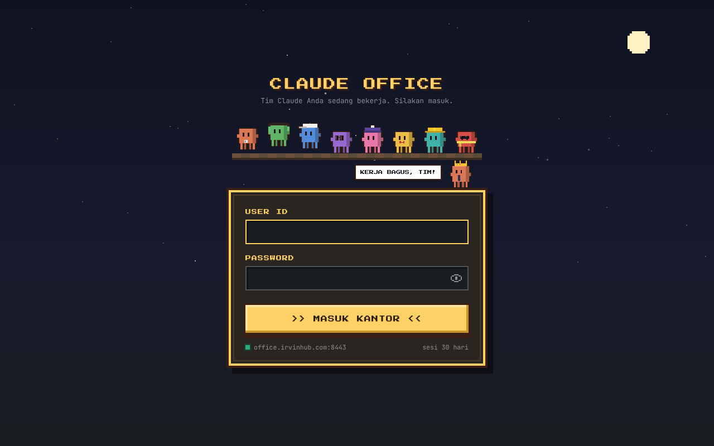

# Claude Office online — office.irvinhub.com

Kantor pixel untuk semua sesi Claude Anda (laptop, VPS, dan cloud) di satu alamat
yang bisa dibuka kapan saja dari browser atau HP.

```
Laptop (Claude Code) ──hook + token──┐
Claude Code di VPS ──hook (lokal)────┼──▶ office.irvinhub.com ──▶ browser / HP Anda
Sesi cloud claude.ai/code ──token────┘        (login + token)
```

## Keamanan singkat

- Halaman kantor dikunci dengan **halaman login** (User ID + password, tetap login).
  Keluar: `https://office.irvinhub.com/logout`.
- Semua data (sesi, prompt, balasan) dan koneksi live juga butuh **token kantor**.
  Tanpa token, server menjawab `401`, walaupun lolos login.
- Perintah `@nama-sesi` dari chat hanya diterima dari halaman kantor yang sudah
  login (lihat bagian 5).
- Hook mengirim token lewat header dari file berizin `600`, jadi token tidak pernah
  muncul di command line.
- Token = kunci rumah. Jangan dibagikan atau di-commit ke git.

## 1. DNS

Di pengelola DNS irvinhub.com, tambahkan record:

| Tipe | Nama | Nilai |
|---|---|---|
| A | `office` | IP VPS Anda |

## 2. Pasang di VPS

Login SSH ke VPS sebagai user yang biasa menjalankan Claude Code, lalu:

```bash
git clone https://github.com/ItsMiracless/Claude-Office.git claude-office && cd claude-office
```
```bash
sudo bash deploy/install-vps.sh office.irvinhub.com
```

Skrip ini akan:
- memasang Node 22,
- membangun kantor ke `/opt/claude-office`,
- menjalankannya sebagai service `claude-office`,
- memasang HTTPS + halaman login (service `claude-office-login`). Kalau nginx sudah dipakai untuk irvinhub.com, skrip memakai
  nginx + certbot. Kalau belum ada, skrip memasang Caddy.
- memasang hook untuk Claude Code di VPS itu.

Di akhir, skrip mencetak **token kantor** untuk langkah 3 dan 4. Untuk melihat
kantor, buka `https://office.irvinhub.com` lalu login. Token kantor otomatis
diberikan ke browser setelah login.

Update di kemudian hari: `git pull`, lalu jalankan lagi perintah `install-vps.sh` yang
sama. Token dan password login tidak berubah.

## 2b. Auto-deploy dari GitHub (sekali saja)

Setelah ini, setiap commit baru di `main` otomatis live dalam ±2 menit, tanpa
token GitHub pribadi:

```bash
cd ~/claude-office && git pull
```
```bash
sudo bash deploy/enable-auto-update.sh office.irvinhub.com
```

Skrip membuat **deploy key hanya-baca**, lalu mencetak *public key*-nya.
Public key aman dibagikan. Tambahkan di GitHub → Claude-Office → Settings →
Deploy keys (jangan centang *write access*), atau kirim ke Claude untuk
ditambahkan. Setelah itu tekan Enter. Skrip memasang timer
`claude-office-update.timer`, lalu langsung mendeploy versi terbaru.

- Log: `journalctl -u claude-office-update -n 50`
- Versi yang sedang live: header `X-Claude-Office-Version` di `/login`
- Matikan: `sudo systemctl disable --now claude-office-update.timer`
- Versi live tertinggal dari `main`? Lihat log di atas. Sebelum perbaikan
  `safe.directory` di `deploy/auto-update.sh`, setiap putaran timer (berjalan
  sebagai root) gagal dengan `detected dubious ownership` karena checkout milik
  user lain. Sekali `git pull` + `sudo bash deploy/install-vps.sh office.irvinhub.com`
  memasang versi yang sudah diperbaiki; setelah itu timer berjalan lagi.



## 3. Sambungkan laptop

Di laptop (macOS/Linux, atau Windows lewat WSL/Git Bash), dari folder project ini:

```bash
bash deploy/connect-laptop.sh https://office.irvinhub.com
```

Masukkan token saat diminta. Setelah itu, setiap sesi Claude Code baru di laptop
muncul di kantor online.

Untuk kembali ke kantor lokal: `rm ~/.agent-office/server-url`.

## 4. Sesi cloud (claude.ai/code)

Sesi cloud berjalan di container Anthropic, jadi butuh dua hal di environment cloud Anda:
1. **Network secret** untuk host `office.irvinhub.com` berisi token kantor (Bearer).
   Proxy cloud menyisipkannya otomatis, jadi token tidak ditulis di mana pun.
2. **Setup script** yang memasang hook dan menulis alamat kantor:
   ```bash
   git clone --depth 1 https://github.com/ItsMiracless/Claude-Office.git /opt/claude-office
   mkdir -p ~/.agent-office && echo https://office.irvinhub.com > ~/.agent-office/server-url
   bash /opt/claude-office/hooks/install-hooks.sh </dev/null
   ```

Minta Claude di sesi cloud untuk menyiapkan keduanya. Network secret diisi lewat
formulir aman, tidak lewat chat.

## 5. Kirim perintah ke sesi dari chat (`@nama-sesi`)

Di kantor online, ketik di chat **#office-general**:

```
@nama-sesi jalankan test lalu perbaiki yang gagal
```

Saat mengetik `@`, chat menawarkan nama sesi yang bisa dikirimi (Tab memilih yang
pertama). Namanya juga terlihat di kartu sesi di kantor: nama sesi Claude Code
(`/rename`), atau judul/project-nya. Perintah menunggu di kantor dan diambil hook
**Stop** sesi itu, lalu chat menulis *📬 … picked up the prompt*.

- **Sesi yang sedang bekerja** menerima perintah begitu gilirannya selesai.
- **Sesi yang diam** (menunggu di kotak input) baru menerima saat giliran
  *berikutnya* selesai: beri sesi itu apa saja di terminalnya dulu. Hook tidak
  bisa membangunkan sesi yang diam.
- Batas: 5 perintah antre per sesi, 2000 karakter per perintah, kedaluwarsa
  1 jam, hilang bila server restart atau sesi berakhir.
- Sesi laptop/cloud perlu hook versi ini (`connect-laptop.sh` lagi, atau setup
  script cloud mengambil versi terbaru) dan token kantor di sesi itu
  (file token atau `AGENT_OFFICE_TOKEN`) untuk memeriksa bukti HMAC. Hook remote
  bertanya ke kantor di setiap Stop (satu request, maks. ±6 detik bila kantor
  tidak menjawab).

Pengaman: hanya **halaman kantor yang sudah login** yang bisa mengantre perintah.
nginx memeriksa cookie login untuk `/chat` dan baru menambahkan header
`X-Office-Login` (header yang sama dari browser selalu dibuang); server juga
meminta UI token halaman kantor dan koneksi dari nginx di mesin yang sama. Token
kantor (hook/laptop) dan link ponsel Wi-Fi tidak bisa. Ditolak? Chat menulis
*🔒 Only the signed-in office page …*: login ulang di `/login`.

## Perintah berguna di VPS

```bash
systemctl status claude-office claude-office-login
```
```bash
journalctl -u claude-office -f
```
```bash
sudo systemctl restart claude-office claude-office-login
```

## Lupa / ganti password login

Di VPS (User ID tidak membedakan huruf besar/kecil):

```bash
cd ~/claude-office && sudo bash deploy/reset-login.sh
```

Semua perangkat akan keluar dan perlu login ulang dengan password baru.

## Lama sesi login

Default: **tetap login** (permanen). Cookie diperpanjang otomatis setiap hari
selama kantor dibuka, dan berakhir hanya kalau Anda logout, password diganti,
atau browser menghapus cookie. Untuk membatasi, misalnya 30 hari, tambahkan
`Environment=OFFICE_SESSION_DAYS=30` di `/etc/systemd/system/claude-office-login.service`,
lalu jalankan `sudo systemctl daemon-reload && sudo systemctl restart claude-office-login`.
